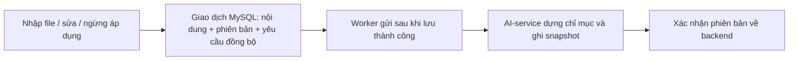

# Nhập clean.json và tự động cập nhật RAG

## 1. Chuẩn bị một lần cho database đang dùng

Chạy từ thư mục gốc dự án. Thay `root` bằng tài khoản được phép tạo bảng và mở rộng cột trong database của bạn; nhập mật khẩu khi MySQL yêu cầu.

```bash
mysql --default-character-set=utf8mb4 -u root -p dvc_guide < infrastructure/database/migrations/20261128_rag_vietnamese_names.sql
```

Script tạo ba bảng có tên tiếng Việt không dấu, mở rộng tên giấy tờ thành `TEXT` và tên tiền tệ thành 50 ký tự. Nếu trước đó đã tạo bảng tiếng Anh bằng script ngày 27/11, script mới đổi tên bảng và cột tại chỗ, giữ dữ liệu hiện có và quan hệ khóa ngoại. Script chạy lại được. Với database mới, `infrastructure/database/schema.sql` đã dùng tên tiếng Việt.

Bạn có thể mở `infrastructure/database/migrations/20261128_rag_vietnamese_names.sql`, copy toàn bộ nội dung vào tab **SQL** của phpMyAdmin/MySQL Workbench rồi chạy. Dừng backend trước khi chuyển tên; chạy SQL thành công rồi khởi động lại backend với code đã cập nhật.

| Tên bảng cũ | Tên bảng hiện tại | Nội dung |
|---|---|---|
| `procedure_source` | `thu_tuc_du_lieu_goc` | JSON nguồn đầy đủ của thủ tục |
| `rag_sync_job` | `hang_doi_dong_bo_rag` | Yêu cầu và trạng thái đồng bộ |
| `document_form` | `thanh_phan_ho_so_bieu_mau` | Liên kết giấy tờ với các biểu mẫu |

Các cột mới:

- `thu_tuc_du_lieu_goc`: `thu_tuc_id`, `du_lieu_goc`.
- `hang_doi_dong_bo_rag`: `thu_tuc_id`, `phien_ban_can_dong_bo`, `phien_ban_da_dong_bo`, `trang_thai`, `so_lan_thu`, `so_doan`, `thu_lai_luc`, `giu_den_luc`, `loi_gan_nhat`, `dong_bo_luc`.
- `thanh_phan_ho_so_bieu_mau`: `thanh_phan_id`, `bieu_mau_id`, `thu_tu`. Tên `thanh_phan_id` thống nhất với bảng `ho_so_checklist`.

Backend ánh xạ tên bảng/cột bằng `@Table` và `@Column`. Các mã trạng thái `PENDING`, `PROCESSING`, `SYNCED`, `FAILED` tiếp tục được hiển thị bằng nhãn tiếng Việt trên admin.

Nếu cùng tồn tại cả tên bảng cũ và tên mới, script dừng ở bước đổi tên để giữ nguyên hai bộ dữ liệu. Kiểm tra nội dung hai bảng trước khi quyết định hợp nhất. Script dùng `CHANGE COLUMN` tương thích cú pháp đổi tên cột của [MariaDB](https://mariadb.com/docs/server/reference/sql-statements/data-definition/alter/alter-table); các tên bảng cũ được đổi bằng cùng một lệnh [RENAME TABLE](https://dev.mysql.com/doc/refman/8.0/en/rename-table.html).

File 198 thủ tục hiện tại có tên giấy tờ dài tới 3.795 ký tự, tên tiền tệ `VIỆT NAM ĐỒNG`, và giấy tờ có nhiều biểu mẫu. Các giá trị này được giữ nguyên. Biểu mẫu đầu tiên vẫn có ở trường `form` của API chi tiết; trường mới `forms` chứa đầy đủ danh sách.

## 2. Nối backend và AI-service

Backend cần dùng một khóa có trong danh sách `TTHC_API_KEYS` mà AI-service đang sử dụng.

Trong `server/.env`:

```dotenv
AI_SERVICE_URL=http://localhost:8000
AI_SERVICE_API_KEY=GIÁ_TRỊ_KHÓA_CỦA_BẠN
RAG_SYNC_ENABLED=true
RAG_SYNC_TIMEOUT_SECONDS=180
```

Trong môi trường chạy AI-service hoặc `ai-service/.env`:

```dotenv
TTHC_API_KEYS=GIÁ_TRỊ_KHÓA_CỦA_BẠN
```

Nếu AI-service chạy trên máy khác, đặt `AI_SERVICE_URL` thành địa chỉ backend truy cập được. Các API đồng bộ yêu cầu `X-API-Key`; web admin gọi Spring Boot để kiểm tra quyền trước.

Khởi động lại backend sau khi chạy migration và sửa cấu hình. Khởi động AI-service trong môi trường Python hiện có của bạn; giữ nguyên cấu hình Ollama, tên model, cache embedding và ngưỡng trong `gate.json`. Khi lấy cấu hình từ `.env`, nạp các biến trước khi chạy:

```bash
cd ai-service
set -a
source .env
set +a
# Dùng Python/venv bạn đang chạy RAG.
python -m uvicorn app.main:app --host 127.0.0.1 --port 8000
```

`requirements.txt` đã khai báo các thư viện truy xuất. Môi trường mới cần cài chúng; môi trường AI hiện tại có thể tiếp tục dùng các thư viện và model đã cài. Lần đầu nạp BGE-M3/reranker có thể mất thời gian.

Với Docker Compose, đặt `AI_SERVICE_API_KEY` trong `.env` ở thư mục gốc. Compose chuyển cùng khóa cho hai dịch vụ, giữ snapshot RAG trong volume `ai-rag-runtime` và cache trong `ai-rag-cache`.

## 3. Nhập dữ liệu trên web admin

1. Đăng nhập, chọn **Nhập dữ liệu**, URL `/admin/imports`.
2. Chọn file `clean.json`, tối đa 20 MB và 10.000 thủ tục.
3. Chọn **Bỏ qua thủ tục đã có** hoặc **Cập nhật thủ tục đã có** theo mã thủ tục.
4. Chọn **Đang áp dụng** để đưa vào nguồn RAG hoặc **Bản nháp** để lưu trước.
5. Bấm **Xem trước dữ liệu**. Kiểm tra số dòng thêm mới, cập nhật, bỏ qua, có lỗi và bảng chi tiết.
6. Bấm **Xác nhận nhập**. Các dòng hợp lệ được lưu; dòng lỗi được báo riêng. Nếu thủ tục thay đổi sau lúc xem trước, dòng cập nhật đó bị từ chối để bạn xem trước lại.
7. Mở **Xem trạng thái đồng bộ RAG** để theo dõi.

Chế độ cập nhật thay nội dung nguồn, giấy tờ, trình tự, cách nộp, lệ phí, kết quả và liên kết văn bản theo bản trong file. Dữ liệu nguồn đầy đủ được giữ trong `thu_tuc_du_lieu_goc`, bao gồm ID nguồn, trường bổ sung, nhiều biểu mẫu và các giá trị `null`; ID database được cấp riêng. Các thông tin cơ quan đã được xác minh, gắn thủ công trong database được giữ.

## 4. Xem và thử lại đồng bộ

Mở **Đồng bộ RAG**, URL `/admin/ai-sources`. Trang tự cập nhật mỗi 5 giây:

| Trạng thái | Ý nghĩa và thao tác |
|---|---|
| Chưa đồng bộ | Chưa có yêu cầu; bấm **Đồng bộ lại** hoặc chờ worker rà soát |
| Chờ đồng bộ | Database đã lưu; đang chờ AI-service xử lý |
| Đang đồng bộ | Worker đang gửi nội dung hoặc chờ cập nhật chỉ mục |
| Đã đồng bộ | RAG đã xác nhận đúng phiên bản đang áp dụng |
| Cần cập nhật | Phiên bản RAG khác database; bấm **Đồng bộ lại** |
| Đồng bộ lỗi | Xem thông báo; kiểm tra địa chỉ, khóa và dịch vụ AI. Hệ thống tự thử lại; có thể bấm thử ngay |
| Đã gỡ khỏi RAG | Bản nháp hoặc thủ tục ngừng áp dụng đã được loại khỏi chỉ mục |

Cột **DB/RAG** cho biết hai phiên bản; số đoạn là số đoạn AI-service đã xác nhận. **Đồng bộ lại trang này** đưa tối đa 20 thủ tục đang hiển thị vào hàng đợi. Có thể đồng bộ lại bản ghi đã thành công để dựng lại chỉ mục.

## 5. Luồng dữ liệu và tránh trả lời từ nguồn cũ



- Mỗi giao dịch thay đổi thủ tục ghi luôn yêu cầu đồng bộ. Rollback thì cả dữ liệu và yêu cầu đều rollback. Worker lấy bản dữ liệu đã commit và gộp các sửa đổi liên tiếp về phiên bản mới nhất.
- Worker kiểm tra hàng đợi mỗi 3 giây. Khi lỗi, thử lại sau khoảng 5, 10, 20 giây… tối đa 5 phút giữa hai lần. Yêu cầu đã lưu vẫn còn sau khi backend khởi động lại. Nếu tiến trình dừng giữa chừng, yêu cầu đang xử lý được lấy lại sau khi hết thời gian giữ 10 phút.
- Khi khởi động và mỗi 60 giây, worker rà soát thủ tục chưa có yêu cầu hoặc thay đổi phiên bản. Thao tác **Đồng bộ lại** đưa yêu cầu về lượt thử tiếp theo.
- AI-service nhận ID database cố định, mã, phiên bản và trạng thái đang áp dụng. Đổi mã vẫn thay đúng bản ghi cũ. Yêu cầu lặp lại cùng phiên bản/nội dung được chấp nhận; phiên bản cũ không ghi đè phiên bản mới.
- Ngừng áp dụng tạo một bản ghi đánh dấu đã gỡ kèm phiên bản. Đánh dấu này được giữ khi AI-service khởi động lại, ngăn yêu cầu cũ đưa thủ tục trở lại.
- Mỗi câu hỏi từ Spring Boot gửi danh sách ID/mã/phiên bản đang áp dụng. RAG chỉ tìm trong các nguồn khớp chính xác. Khi chưa đồng bộ xong bản sửa, hệ thống không dùng bản cũ. Sau khi AI sinh câu trả lời, backend kiểm tra nguồn lần nữa để xử lý trường hợp thủ tục vừa sửa/ngừng áp dụng trong lúc đang chờ model.
- Tìm kiếm và hỏi đáp tự do qua Spring Boot đã dùng danh sách nguồn này. Luồng hỏi về thủ tục đã chọn tiếp tục gửi nội dung mới đọc từ database.

Snapshot mặc định là `ai-service/runtime/rag-state.json`, có thể đổi bằng `TTHC_RUNTIME`. Dữ liệu, phiên bản và các đánh dấu đã gỡ được ghi vào cùng snapshot qua file tạm rồi đổi tên nguyên tử. File `data/clean.json` gốc được giữ để làm dữ liệu khởi đầu/kiểm thử model. Các lệnh kiểm thử AI-service trực tiếp không gửi `allowed_procedures` vẫn hỗ trợ kho độc lập ban đầu; luồng ứng dụng đi qua Spring Boot để áp dụng kiểm tra database.

Thay đổi nội dung không yêu cầu huấn luyện lại hoặc nạp lại GGUF. Hàm chia đoạn và renderer/prompt hiện có được giữ nguyên. Các thay đổi nội dung cần đi qua API quản trị/nhập dữ liệu để cập nhật phiên bản và hàng đợi; khi bổ sung API sửa bảng con, dùng cùng cơ chế này.

Thao tác xóa trên admin hiện là **Ngừng áp dụng**, giữ hồ sơ và lịch sử đã lưu trong database, đồng thời loại nguồn khỏi các câu trả lời mới.

## 6. API

| API | Nội dung |
|---|---|
| `POST /api/v1/admin/imports/preview` | JSON gồm `procedures`, `duplicatePolicy`, `status`; xem trước |
| `POST /api/v1/admin/imports/preview-file` | Multipart `file`, tham số `duplicatePolicy`, `status`; xem trước file |
| `POST /api/v1/admin/imports/confirm` | `request` là nội dung đã xem trước, `expectedVersions` là mã → phiên bản cũ (0 nếu thêm mới) |
| `GET /api/v1/admin/rag/sources?page=0&size=20` | Danh sách trạng thái |
| `POST /api/v1/admin/rag/sync` | `targets: [{procedureId, expectedVersion}]`; đưa lại vào hàng đợi |
| `PUT /api/v1/rag/procedures/{id}` | API nội bộ AI-service; `version`, `code`, `active`, `procedure` và header `X-API-Key` |

Các API admin dùng cùng phiên đăng nhập và CSRF của web admin. HTTP Basic dùng được khi không gửi kèm cookie phiên.

## 7. Kiểm thử

```bash
cd server
mvn test
```

```bash
cd ai-service
python -m pytest
```

Test backend dùng H2 trong bộ nhớ, gồm nhập đủ dữ liệu mẫu 198 thủ tục, giữ nhiều biểu mẫu, rollback hàng đợi, lỗi/thử lại, xung đột phiên bản và kiểm tra nguồn. Test Python dùng embedding/model mô phỏng để kiểm tra truy xuất, snapshot, đổi mã, gỡ nguồn và từ chối phiên bản cũ mà không tải model thật. Chất lượng câu trả lời của model cần kiểm tra riêng bằng các câu smoke test của bạn.
